<div align="center">


<a href="https://git.io/typing-svg"></a>

<br/>

<a href="https://portafolio.kleverontaneda.workers.dev"></a>
<a href="mailto:kleverontaneda@gmail.com"></a>
<a href="https://www.linkedin.com/in/klever-ontaneda-loja-ecuador"></a>


</div>

---

## About

Backend engineer based in Loja, Ecuador. For the past two years I have designed, built and operated the production ERP of a multi-branch pharmacy chain: purchasing, inventory, point of sale, electronic invoicing and the integrations that tie them together.

Take a walk through my work in the interactive portfolio: **[One night at the club](https://portafolio.kleverontaneda.workers.dev)**.

I care about correctness under real load, data that reconciles to the cent, and automation that runs every night without anyone noticing.

```python
class Klever:
    role     = "Backend Engineer"
    stack    = ["Python", "Django", "Odoo 17", "PostgreSQL", "Docker", "AWS"]
    location = "Loja, Ecuador (UTC-5)"
    focus    = ["ERP architecture", "System integration", "Data integrity", "Automation"]
```

---

## Impact

<div align="center">

| 2+ years | 900+ | 100k+ | Dozens |
|:---:|:---:|:---:|:---:|
| running a production ERP | commits shipped | products synchronized | warehouses on nightly automation |

</div>

---

## Selected Work

Most of my work lives in private company repositories. These are systems I designed and shipped to production.

| System | What it does |
|---|---|
| **Statistical Replenishment Engine** | Max/min stock model with safety stock, reorder point and per-warehouse coverage. Runs as a nightly job that creates and updates replenishment rules for hundreds of thousands of products. |
| **SRI E-Invoicing Import (Ecuador)** | Parses authorized XML invoices, reconciles VAT, ICE and withholdings, and validates against the authorized total with cent-level auto-correction on posting. |
| **Odoo ↔ External ERP Integration + Offline POS** | Two-way REST sync of products, purchase orders, withholdings and inter-warehouse transfers, plus an offline point of sale with local queue, conflict resolution and barcode sync at 100k+ scale. |
| **ZKTeco Biometric Integration** | Device auto-discovery via network scan, persistent attendance queue and monitoring with automatic retries. |
| **Offline Odoo Installer for Windows** | PyInstaller + Inno Setup package that deploys with zero internet dependency for sites with unstable connectivity. |

---

## Tech Stack

<div align="center">

**Backend**<br/>


**Data and Infrastructure**<br/>


**Frontend**<br/>


</div>

---

## Contributions

<div align="center">



<sub>Every building is a day of commits. Regenerated twice a day.</sub>

</div>

---

<div align="center">



<sub>Every line shipped with <a href="https://www.youtube.com/watch?v=K1hqAA063oo">1950s jazz noir</a> playing in the background.</sub>


</div>
